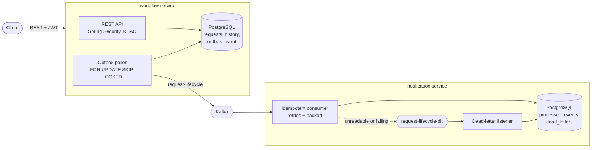

# Enterprise Workflow Management System

An approval-workflow backend built as a set of services: employees submit requests, managers approve or reject them, and every change is published as an event that other services react to reliably.

It is a hands-on learning project, built to practise production backend patterns end to end: transactional outbox, idempotent Kafka consumers, dead-letter handling, schema migrations, and integration testing against real infrastructure.

[](https://github.com/rishuRJ/enterprise-workflow-management-system/actions/workflows/ci.yml)

## Architecture



1. The **workflow service** saves a request change and its event to the `outbox_event` table **in one database transaction**, so an event is never lost and never published for a change that rolled back.
2. A scheduled **outbox poller** publishes pending events to Kafka, with retries, backoff, and recovery of stuck events.
3. The **notification service** consumes the events **idempotently** (a duplicate delivery is ignored), retries transient failures, and sends messages it cannot process to a **dead-letter topic**, where they are stored for investigation instead of blocking the topic.

## Services

| Service | What it does | Stack |
| --- | --- | --- |
| [`workflow`](workflow/README.md) | Users, requests, approvals, audit history, transactional outbox to Kafka | Java 21, Spring Boot 3.5, Spring Security (JWT, RBAC), JPA, PostgreSQL, Flyway, Kafka |
| [`notification`](notification) | Consumes request-lifecycle events; idempotent processing, retries, dead-letter topic | Java 21, Spring Boot 3.5, Spring Kafka, JPA, PostgreSQL |
| `ai-service` | *In progress:* request summaries and questions over request history with Claude (RAG, tool calling) | Python, FastAPI, Anthropic SDK |

Each service owns its own database.

## Engineering highlights

- **Transactional outbox** with retry and backoff (1, 5, 15 minutes), stale-event recovery, a permanently-failed state and an admin replay endpoint.
- **Concurrent-safe polling:** `FOR UPDATE SKIP LOCKED` lets several pollers share work without claiming the same event.
- **Idempotent consumer** keyed on request and action, plus a **dead-letter topic** for poison messages.
- **Optimistic locking** (`@Version`) on concurrent approvals; N+1 queries fixed with `@EntityGraph`.
- **Flyway migrations** and **indexes** for the hot queries, measured with `EXPLAIN ANALYZE` (30-50 ms scans down to under 1 ms on 500k rows).
- **Security:** stateless JWT with BCrypt, role checks at URL and method level, secrets from environment variables.

## Testing

`./mvnw verify` in each service runs its tests:

- **Unit tests** (JUnit 5, Mockito) for the workflow service's business logic.
- **Integration tests** (Testcontainers) in both services, which start the real application against **PostgreSQL 18 and Kafka in Docker**. They cover migrations, search queries, optimistic locking, transaction rollback, concurrent outbox polling, outbox-to-Kafka delivery, duplicate-event handling and dead-lettering. Asynchronous consumers are tested with Awaitility, without fixed sleeps.

GitHub Actions runs all of them for every service on each pull request ([ci.yml](.github/workflows/ci.yml)).

## Running locally

Prerequisites: JDK 21 and Docker.

1. **Workflow service:** follow [workflow/README.md](workflow/README.md). Its Docker Compose file starts PostgreSQL, Kafka and the service on port `8080`; Swagger UI is at http://localhost:8080/swagger-ui.html.
2. **Notification service:** in `notification/`, create a git-ignored `.env`:

   ```
   POSTGRES_DB=notification_db
   POSTGRES_USER=postgres
   POSTGRES_PASSWORD=change-me

   DB_USERNAME=postgres
   DB_PASSWORD=change-me
   ```

   Start its database, then the service with the `local` profile (it uses the Kafka broker from the workflow stack on `localhost:9092`):

   ```bash
   docker compose up -d
   ```

   ```bash
   ./mvnw spring-boot:run -Dspring-boot.run.profiles=local
   ```

## Repository layout

```
.github/workflows/ci.yml   CI for all services
workflow/                  Workflow service (Spring Boot)
notification/              Notification service (Spring Boot)
```
